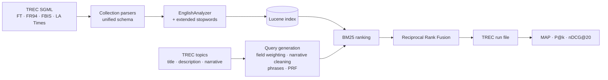

# Query Potter and the Order of the Index

A Lucene search engine for TREC news retrieval, built around query formulation: field-aware weighting, narrative cleaning, pseudo-relevance feedback and Reciprocal Rank Fusion on top of tuned BM25.

  

Group 27's project for CS7IS3 Information Retrieval & Web Search at Trinity College Dublin (2025). The system indexes four TREC news collections — *Financial Times*, *Federal Register*, *Foreign Broadcast Information Service* and *Los Angeles Times* — into a unified schema, and returns 1,000 ranked documents for each of 50 TREC topics (401–450) in standard TREC run format.

## Results at a glance

- **MAP 0.377**, P@5 0.728, P@20 0.578 and nDCG@20 0.646 on the judged development topics (401–425)
- **+55% MAP** over a title-only BM25 baseline (0.244 → 0.377)
- Nearly all of that gain came from **how queries were built**, not from the choice of ranking model

| Configuration | MAP | P@20 | nDCG@20 |
|---|---:|---:|---:|
| Title only (baseline) | 0.2437 | 0.422 | 0.4304 |
| Title + description | 0.2970 | 0.482 | 0.5183 |
| Title + description + cleaned narrative | 0.3162 | 0.506 | 0.5498 |
| Multi-query RRF | 0.3029 | 0.498 | 0.5446 |
| PRF ensemble | 0.3244 | 0.496 | 0.5474 |
| **Final system** | **0.3773** | **0.578** | **0.6460** |

*BM25 (k1 = 0.5, b = 1.0), 1,000 results per topic. Full method and discussion in the [project report](docs/report.pdf); evaluation details and limitations in [EVALUATION.md](docs/EVALUATION.md).*

## Key findings

1. **Query design mattered more than the ranking model.** Swapping BM25 for a Dirichlet language model, or tuning BM25's parameters, moved MAP far less than restructuring the queries did.
2. **The narrative field only helps once it's filtered.** TREC narratives describe what is *not* relevant as often as what is. Adding them raw hurt MAP; removing those sentences turned the narrative into a useful signal.
3. **Pseudo-relevance feedback gave the largest single gain, but it's fragile.** Conservative limits on feedback documents and expansion terms were essential; aggressive expansion caused topic drift.

## How it works



- **Parsing:** a dedicated parser per collection maps inconsistent SGML into `DOCNO`, `TITLE`, `AUTHOR`, `DATE` and `BODY` fields.
- **Analysis:** Lucene's `EnglishAnalyzer` (tokenisation, possessive removal, Porter stemming), optionally with a 174-term extended stopword list.
- **Query generation:** title as a boosted required clause, description as weaker optional terms, cleaned narrative as a weak signal, repeated title clauses at decreasing weights, and boosted title bigrams.
- **Pseudo-relevance feedback:** expansion terms selected by TF-IDF from the top-ranked documents and added back as boosted terms.
- **Rank fusion:** complementary query variants combined with Reciprocal Rank Fusion (k = 100), which avoids comparing Lucene's raw scores across queries.

A component-by-component walkthrough is in [ARCHITECTURE.md](docs/ARCHITECTURE.md).

## Getting started

**Requirements:** Java 17, Maven 3, and Python 3 for the evaluation scripts.

**Data:** the document collection is TREC Disks 4 & 5 (minus the Congressional Record), which is licensed by NIST and not included here. It can be [requested from NIST](https://trec.nist.gov/data/docs_eng.html). The TREC-8 ad hoc topics (401–450) and relevance judgements are available from the [TREC website](https://trec.nist.gov/data/topics_eng/).

```bash
# Build
mvn clean package

# Index the four collections
java -jar target/cs7is3-search-1.0.0.jar index \
  --docs /path/to/collections --index index

# Run the 50 topics with the final configuration (all defaults)
java -jar target/cs7is3-search-1.0.0.jar search \
  --index index --topics /path/to/topics --output runs/final.run

# Score the run
python3 tools/evaluate.py /path/to/qrels runs/final.run \
  --out_csv out/results.csv --out_md out/results.md
```

### Options

| Option | Default | Values |
|---|---|---|
| `--analyzer` | `ENGLISH_STOP_WORDS` | `ENGLISH`, `ENGLISH_STOP_WORDS` |
| `--similarity` | `BM25` | `BM25`, `DIRICHLET` |
| `--bm25k1` / `--bm25b` | `0.5` / `1.0` | any float |
| `--query` | `PRF_TITLE_DESC_NARRATIVE_CLEANED` | `TITLE_ONLY`, `BOOSTED_TITLE`, `TITLE_DESC`, `TITLE_DESC_NARRATIVE_CLEANED`, `MULTI_QUERY_RRF`, `PRF_TITLE_DESC_NARRATIVE_CLEANED`, `PRF_ENSEMBLE_TDN` |
| `--query-parser` | `WEAK_TITLE_STRONG_CONTENT` | `UNIFORM_MULTI_FIELDS`, `WEAK_TITLE_STRONG_CONTENT` |
| `--numDocs` | `1000` | results per topic |

There is also an `evaluate` mode that runs every query mode and parser combination in parallel and scores each against a qrels file:

```bash
java -jar target/cs7is3-search-1.0.0.jar evaluate \
  --docs /path/to/collections --topics /path/to/topics --qrels /path/to/qrels
```

## Repository layout

```text
├── src/main/java/org/cs7is3/
│   ├── App.java                    # CLI entry point: index, search, evaluate
│   ├── Indexer.java                # Builds the Lucene index
│   ├── Searcher.java               # Retrieval, PRF, RRF and TREC output
│   ├── QueryGeneratorFactory.java  # All query strategies
│   ├── AnalyzerFactory.java        # Text analysis options
│   ├── SimilarityFactory.java      # BM25 / Dirichlet
│   ├── Evaluator.java              # Parallel grid evaluation
│   ├── config/                     # Tuned defaults
│   └── parsing/                    # Collection, topic and CLI parsers
├── tools/
│   ├── evaluate.py                 # MAP, P@20, nDCG@20
│   └── evaluate_per_topic.py       # Per-topic breakdown
└── docs/
    ├── ARCHITECTURE.md
    ├── EVALUATION.md
    └── report.pdf                  # Full project report
```

## Team

Built by **Sam Taylor, Sai Ruthwik Thummurugoti, Tanya Tiwari, Leah Weldon and Pranjal Yadav**. See [CONTRIBUTIONS.md](CONTRIBUTIONS.md) for who did what.

**My contribution (Leah Weldon):** My focus was retrieval and query optimisation. I implemented pseudo-relevance feedback and phrase matching, the title/description/narrative query modes with narrative cleaning, BM25 parameter tuning from the command line, and the multi-scale title weighting used in the final system, and I ran the topic-level tuning and per-topic diagnostics. I also kept the team's project journal and contributed to the report's methodology sections on query generation and retrieval models.

## References

- S. Robertson and S. Walker. *Some simple effective approximations to the 2-Poisson model for probabilistic weighted retrieval.* SIGIR 1994.
- G. Cormack, C. Clarke and S. Büttcher. *Reciprocal rank fusion outperforms Condorcet and individual rank learning methods.* SIGIR 2009.
- C. Zhai and J. Lafferty. *A study of smoothing methods for language models applied to ad hoc information retrieval.* SIGIR 2001.
- E. Voorhees and D. Harman. *Overview of the Eighth Text REtrieval Conference (TREC-8).* NIST, 2000.
