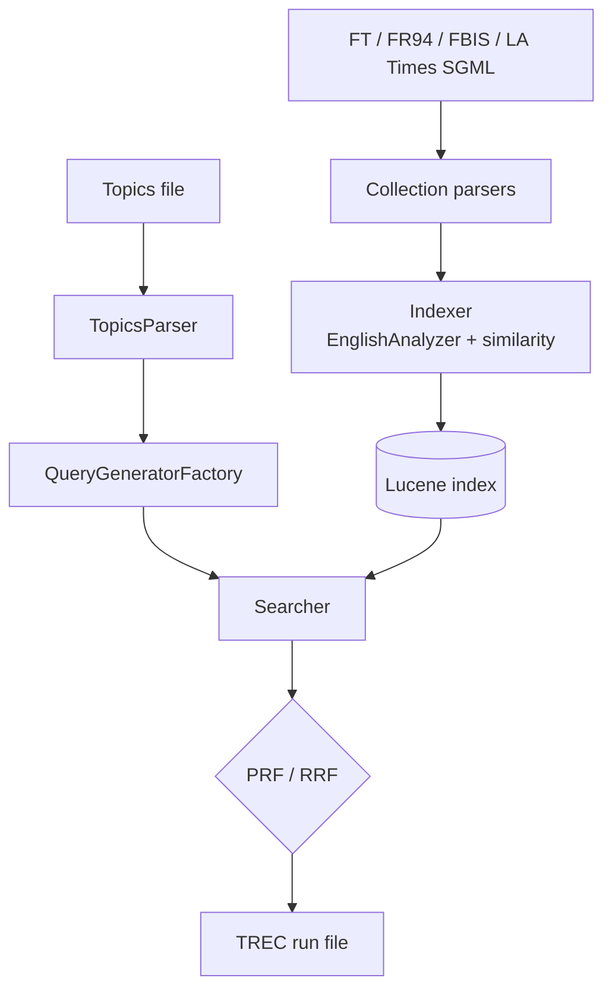

# Architecture

Query Potter is a command-line pipeline with three modes: `index`, `search` and `evaluate`. Every stage is configurable from the CLI, so the same code runs the baseline, each intermediate experiment and the final system.

## Components

| Component | Source | What it does |
|---|---|---|
| CLI | [`App`](../src/main/java/org/cs7is3/App.java), [`ArgsParser`](../src/main/java/org/cs7is3/parsing/ArgsParser.java) | Parses the mode and options, applies tuned defaults from [`config/Defaults`](../src/main/java/org/cs7is3/config/Defaults.java) |
| Document parsing | [`parsing/`](../src/main/java/org/cs7is3/parsing/) | One parser per collection, all producing the same `DOCNO` / `TITLE` / `AUTHOR` / `DATE` / `BODY` record |
| Topic parsing | [`TopicsParser`](../src/main/java/org/cs7is3/parsing/TopicsParser.java) | Extracts number, title, description and narrative from the TREC topics file |
| Indexing | [`Indexer`](../src/main/java/org/cs7is3/Indexer.java) | Writes the Lucene index; identifiers and metadata as `StringField`s, title and body as analysed `TextField`s |
| Analysis | [`AnalyzerFactory`](../src/main/java/org/cs7is3/AnalyzerFactory.java) | `EnglishAnalyzer`, optionally with a 174-term extended stopword list |
| Ranking | [`SimilarityFactory`](../src/main/java/org/cs7is3/SimilarityFactory.java) | BM25 with configurable k1 and b, or a Dirichlet-smoothed language model |
| Query generation | [`QueryGeneratorFactory`](../src/main/java/org/cs7is3/QueryGeneratorFactory.java) | Seven query strategies, from title-only through to PRF ensembles |
| Retrieval | [`Searcher`](../src/main/java/org/cs7is3/Searcher.java) | Runs each topic, applies PRF and RRF where the query mode asks for them, writes TREC output |
| Grid evaluation | [`Evaluator`](../src/main/java/org/cs7is3/Evaluator.java) | Runs every query mode and parser combination in parallel and scores each one |
| Scoring scripts | [`tools/`](../tools/) | MAP, P@20 and nDCG@20, overall and per topic |

## Design decisions

**One schema for four collections.** The four collections use different SGML tags and metadata conventions. Normalising them at parse time means indexing, querying and scoring never need to know which collection a document came from.

**Queries as interchangeable strategies.** Each query mode is its own generator class behind a single interface, selected with `--query`. This made it cheap to add a new idea and compare it directly against the others under identical indexing and ranking.

**Narrative cleaning.** TREC narratives often spell out what is *not* relevant ("documents discussing X are not relevant"). Sentences containing phrases like "not relevant" are removed before the narrative is added to the query, and what remains is added only as a weak optional clause.

**Multi-scale title weighting.** The title was the strongest single indicator of relevance, so the final query adds the title several times at decreasing boosts. Documents matching the full title rank highest, while documents matching part of it are still rewarded.

**Conservative pseudo-relevance feedback.** The top 50 results for the initial query form the feedback set. Terms from the top 20 of those are scored by TF-IDF, and the best 30 are added to the query as boosted body terms. Larger values caused the query to drift away from the topic.

**Rank fusion instead of score fusion.** Lucene scores from different queries aren't on a comparable scale, so complementary queries are combined with Reciprocal Rank Fusion, which uses only each document's rank in each list. The smoothing constant was tuned to k = 100 (the original paper uses 60).
